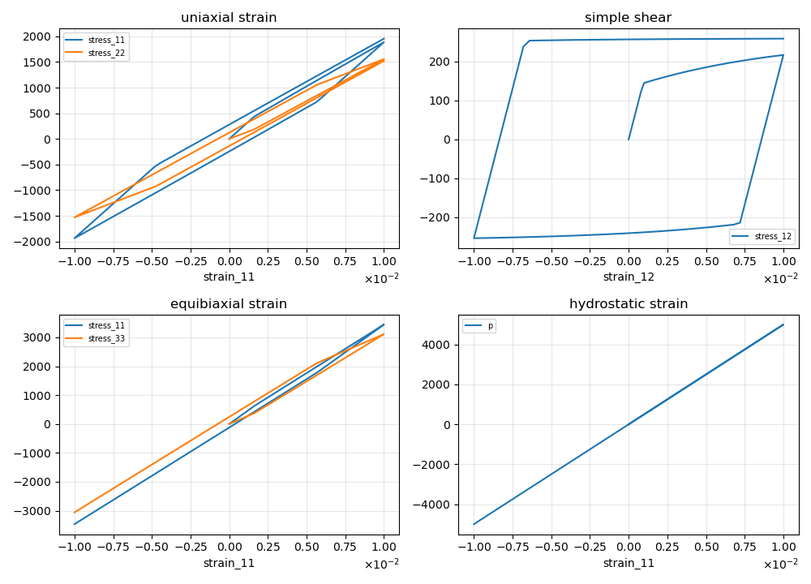
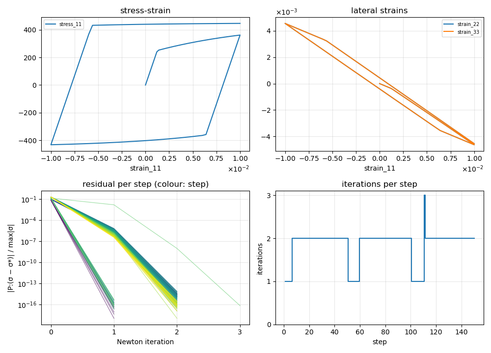
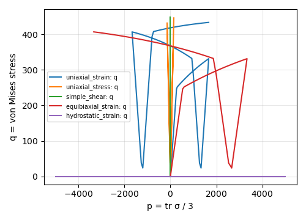
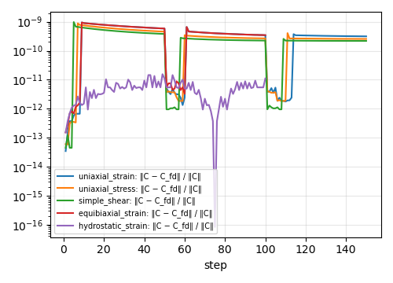
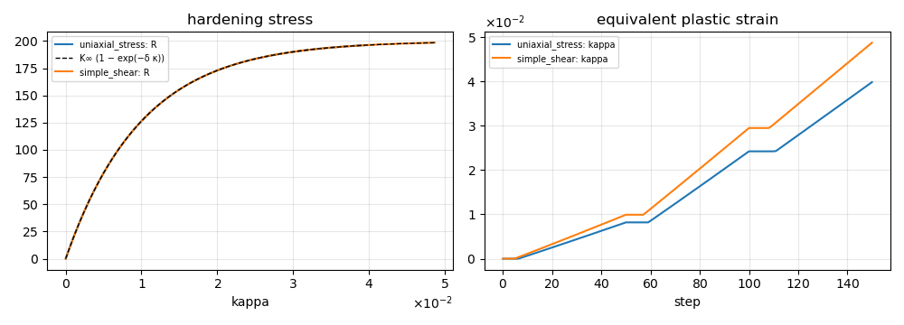

# exponential_isotropic_hardening

Saturating isotropic hardening (Voce type) for the plasticity models; reported here with `j2_plasticity` as host.

## Equations

$$
R(\kappa) = K_\infty\left(1 - e^{-\delta\kappa}\right), \qquad
R'(\kappa) = K_\infty\,\delta\,e^{-\delta\kappa}
$$

$R$ is the increase of the yield stress over $\sigma_0$ and saturates at $K_\infty$; $\delta$ sets how fast.
Because $R'$ changes with $\kappa$, the return map and the uniaxial-stress Newton both iterate; their convergence is shown below.

## Implementation

[`exponential_isotropic_hardening.h`](../../../include/numsim-materials/materials/exponential_isotropic_hardening.h)

| | name | type |
|---|---|---|
| parameter | `K_inf`, `delta` | number |
| parameter | `source` | material providing `equivalent_plastic_strain` $\kappa$ |
| output | `hardening_stress` | $R$ |
| output | `hardening_modulus` | $R'$ |

The host re-evaluates the node for every iterate of its return map (`update_source()`).

<!-- report:begin -->
## Results

Generated by `reports/make_report.py` from [`report.json`](report.json) at `v0.1.0-7-g01c0cdb-dirty` on 2026-10-16; do not edit.

### Load cases

| case | control | steps | iterations (max / mean) | max tangent error | converged |
|---|---|---|---|---|---|
| uniaxial_strain | strain | 150 | 0 / 0.00 | 9.5e-10 | yes |
| uniaxial_stress | uniaxial_stress | 150 | 3 / 1.84 | 8.8e-10 | yes |
| simple_shear | strain | 150 | 0 / 0.00 | 9.8e-10 | yes |
| equibiaxial_strain | strain | 100 | 0 / 0.00 | 9.5e-10 | yes |
| hydrostatic_strain | strain | 100 | 0 / 0.00 | 1.6e-11 | yes |

### Checks

| check | cases | max error (case) | tolerance | result |
|---|---|---|---|---|
| tangent vs central differences | 5 | 9.8e-10 (simple_shear) | 1e-06 | pass |
| R = K∞ (1 − exp(−δ κ)) | 5 | 0.0e+00 (uniaxial_strain) | 1e-12 | pass |
| R' = K∞ δ exp(−δ κ) | 5 | 0.0e+00 (uniaxial_strain) | 1e-12 | pass |
| on or inside the yield surface | 5 | 9.6e-11 (uniaxial_strain) | 1e-08 | pass |
| at most 6 Newton iterations | 1 | 0.0e+00 (uniaxial_stress) | 0e+00 | pass |

### Stress for prescribed strain paths



### Uniaxial stress (1D) and its Newton iterations

Strain 11 is prescribed; the other five strains are solved for zero stress with the material tangent.



### Stress paths in the p–q plane



### Tangent check

Relative difference between the material tangent and central differences of the stress at the converged state.



### Hardening



### Graph

Properties wired between the materials of this report (`material::property`).

```mermaid
flowchart LR
  strain["strain<br/><small>external_strain_source</small>"]
  solver["solver<br/><small>local_newton</small>"]
  hardening["hardening<br/><small>exponential_isotropic_hardening</small>"]
  j2["j2<br/><small>j2_plasticity</small>"]
  j2 -->|equivalent_plastic_strain (local)| hardening
  strain -->|strain| j2
  hardening -->|hardening_stress (local)| j2
  hardening -->|hardening_modulus (local)| j2
```

| material | type | produces | consumes |
|---|---|---|---|
| strain | `external_strain_source` | strain (history) |  |
| solver | `local_newton` |  |  |
| hardening | `exponential_isotropic_hardening` | hardening_stress, hardening_modulus | j2::equivalent_plastic_strain |
| j2 | `j2_plasticity` | equivalent_plastic_strain (history), stress, tangent, plastic_strain (history) | strain::strain, hardening::hardening_stress, hardening::hardening_modulus |

### Parameters

| material | parameter | value |
|---|---|---|
| hardening | `delta` | 100.0 |
| hardening | `K_inf` | 200.0 |
| hardening | `source` | "j2" |
| j2 | `sigma_0` | 250.0 |
| j2 | `K` | 166666.67 |
| j2 | `solver_source` | "solver" |
| j2 | `strain_source` | "strain" |
| j2 | `hardening_source` | "hardening" |
| j2 | `G` | 76923.08 |
<!-- report:end -->
