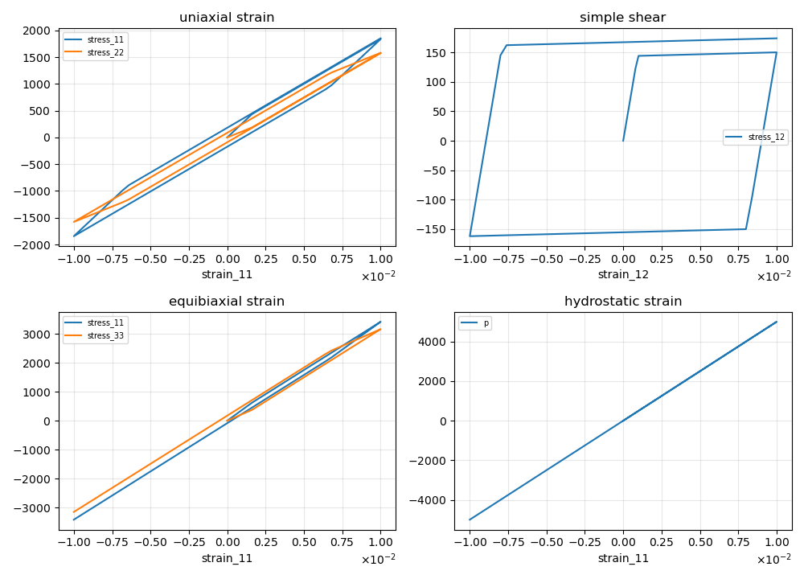
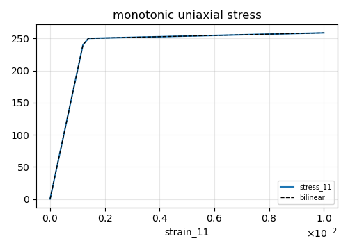
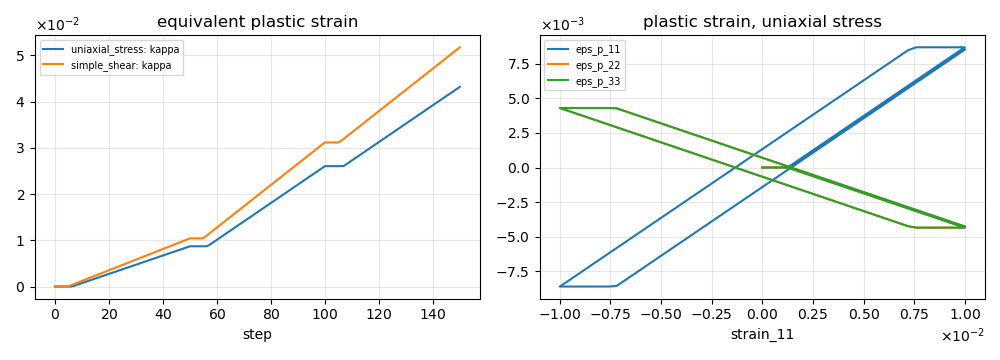

# j2_plasticity

Small-strain von Mises (J2) plasticity with isotropic hardening, return mapping and the consistent tangent.
The theory in full is in [`plasticity-theory.md`](../../plasticity-theory.md); the design in [`plasticity.md`](../../plasticity.md).

## Equations

Additive split and elastic law:

$$
\boldsymbol{\varepsilon} = \boldsymbol{\varepsilon}^e + \boldsymbol{\varepsilon}^p, \qquad
\boldsymbol{\sigma} = \mathbb{C}^e : (\boldsymbol{\varepsilon} - \boldsymbol{\varepsilon}^p), \qquad
\mathbb{C}^e = 3K\,\mathbb{P}_\mathrm{vol} + 2G\,\mathbb{P}_\mathrm{dev}
$$

Yield function, associative flow and hardening ($\kappa$ = equivalent plastic strain, $R(\kappa)$ from the hardening material):

$$
f = \sigma_\mathrm{eq} - \sigma_0 - R(\kappa), \qquad
\sigma_\mathrm{eq} = \sqrt{\tfrac32\,\mathbf{s}:\mathbf{s}}, \qquad
\mathbf{s} = \operatorname{dev}\boldsymbol{\sigma}
$$

$$
\dot{\boldsymbol{\varepsilon}}^p = \dot\lambda\,\mathbf{N}, \qquad
\mathbf{N} = \frac{3}{2}\frac{\mathbf{s}}{\sigma_\mathrm{eq}}, \qquad
\dot\kappa = \dot\lambda, \qquad
\dot\lambda \ge 0,\; f \le 0,\; \dot\lambda f = 0
$$

Backward Euler with radial return. Trial state $\boldsymbol{\sigma}^\mathrm{tr} = \mathbb{C}^e : (\boldsymbol{\varepsilon}_{n+1} - \boldsymbol{\varepsilon}^p_n)$; if $f^\mathrm{tr} > 0$ solve the scalar equation

$$
r(\Delta\lambda) = \sigma^\mathrm{tr}_\mathrm{eq} - 3G\,\Delta\lambda - \sigma_0 - R(\kappa_n + \Delta\lambda) = 0
$$

with Newton ($r' = -3G - R'$), then

$$
\boldsymbol{\sigma}_{n+1} = \boldsymbol{\sigma}^\mathrm{tr} - 2G\,\Delta\lambda\,\mathbf{N}, \qquad
\boldsymbol{\varepsilon}^p_{n+1} = \boldsymbol{\varepsilon}^p_n + \Delta\lambda\,\mathbf{N}, \qquad
\kappa_{n+1} = \kappa_n + \Delta\lambda .
$$

Consistent tangent:

$$
\mathbb{C} = \mathbb{C}^e - \frac{6G^2\Delta\lambda}{\sigma^\mathrm{tr}_\mathrm{eq}}\,\mathbb{P}_\mathrm{dev}
+ \left(\frac{4G^2\Delta\lambda}{\sigma^\mathrm{tr}_\mathrm{eq}} - \frac{4G^2}{3G + R'}\right)\mathbf{N}\otimes\mathbf{N}
$$

Uniaxial stress with linear hardening $R = H\kappa$: $\sigma_{11} = E\varepsilon_{11}$ up to $\sigma_0$, then
$\mathrm{d}\sigma_{11}/\mathrm{d}\varepsilon_{11} = EH/(E+H)$, i.e. $\sigma_{11} = (\varepsilon_{11} + \sigma_0/H)/(1/E + 1/H)$.

## Implementation

[`j2_plasticity.h`](../../../include/numsim-materials/materials/j2_plasticity.h)

| | name | type |
|---|---|---|
| parameter | `K`, `G`, `sigma_0` | number |
| parameter | `strain_source` | material providing `strain` |
| parameter | `hardening_source` | material providing `hardening_stress` $R$ and `hardening_modulus` $R'$ |
| parameter | `solver_source` | `local_newton` used for the scalar return map |
| output | `stress`, `tangent` | rank-2, rank-4 tensor |
| history | `plastic_strain` | rank-2 tensor $\boldsymbol{\varepsilon}^p$ |
| history | `equivalent_plastic_strain` | scalar $\kappa$ |

- The hardening is a separate graph node (`linear_isotropic_hardening`, `exponential_isotropic_hardening`); the return map re-evaluates it per Newton iterate.
- The closed-form tangent requires isotropic $\mathbb{C}^e$ ($\mathbb{C}^e:\mathbf{N} = 2G\mathbf{N}$), which is why the stiffness is built from `K`, `G` here.
- A negative multiplier ($R' < -3G$) throws instead of being clamped.

<!-- report:begin -->
## Results

Generated by `reports/make_report.py` from [`report.json`](report.json) at `v0.1.0-8-g7375e56-dirty` on 2026-10-16; do not edit.

### Load cases

| case | control | steps | iterations (max / mean) | max tangent error | converged |
|---|---|---|---|---|---|
| uniaxial_strain | strain | 150 | 0 / 0.00 | 1.0e-09 | yes |
| uniaxial_stress | uniaxial_stress | 150 | 2 / 1.01 | 1.0e-09 | yes |
| simple_shear | strain | 150 | 0 / 0.00 | 1.1e-09 | yes |
| equibiaxial_strain | strain | 100 | 0 / 0.00 | 1.0e-09 | yes |
| hydrostatic_strain | strain | 100 | 0 / 0.00 | 1.6e-11 | yes |
| uniaxial_stress_monotonic | uniaxial_stress | 50 | 1 / 1.00 | 9.5e-10 | yes |

### Checks

| check | cases | max error (case) | tolerance | result |
|---|---|---|---|---|
| tangent vs central differences | 6 | 1.1e-09 (simple_shear) | 1e-06 | pass |
| bilinear σ11(ε11) | 1 | 4.4e-16 (uniaxial_stress_monotonic) | 1e-10 | pass |
| on or inside the yield surface | 6 | 3.0e-13 (equibiaxial_strain) | 1e-08 | pass |
| plastic incompressibility | 6 | 3.5e-18 (equibiaxial_strain) | 1e-15 | pass |
| κ never decreases | 6 | 0.0e+00 (uniaxial_strain) | 0e+00 | pass |
| R = H κ | 6 | 0.0e+00 (uniaxial_strain) | 1e-12 | pass |
| hydrostatic loading stays elastic | 1 | 0.0e+00 (hydrostatic_strain) | 0e+00 | pass |

### Stress for prescribed strain paths



### Uniaxial stress (1D) and its Newton iterations

Strain 11 is prescribed; the other five strains are solved for zero stress with the material tangent.


### Stress paths in the p–q plane


### Tangent check

Relative difference between the material tangent and central differences of the stress at the converged state.


### Against the closed form



### History variables



### Graph

Properties wired between the materials of this report (`material::property`).

```mermaid
flowchart LR
  strain["strain<br/><small>external_strain_source</small>"]
  solver["solver<br/><small>local_newton</small>"]
  hardening["hardening<br/><small>linear_isotropic_hardening</small>"]
  j2["j2<br/><small>j2_plasticity</small>"]
  j2 -->|equivalent_plastic_strain (local)| hardening
  strain -->|strain| j2
  hardening -->|hardening_stress (local)| j2
  hardening -->|hardening_modulus (local)| j2
```

| material | type | produces | consumes |
|---|---|---|---|
| strain | `external_strain_source` | strain (history) |  |
| solver | `local_newton` |  |  |
| hardening | `linear_isotropic_hardening` | hardening_modulus, hardening_stress | j2::equivalent_plastic_strain |
| j2 | `j2_plasticity` | equivalent_plastic_strain (history), plastic_strain (history), stress, tangent | strain::strain, hardening::hardening_stress, hardening::hardening_modulus |

### Parameters

| material | parameter | value |
|---|---|---|
| hardening | `K` | 1000.0 |
| hardening | `source` | "j2" |
| j2 | `sigma_0` | 250.0 |
| j2 | `K` | 166666.67 |
| j2 | `solver_source` | "solver" |
| j2 | `strain_source` | "strain" |
| j2 | `hardening_source` | "hardening" |
| j2 | `G` | 76923.08 |
<!-- report:end -->
