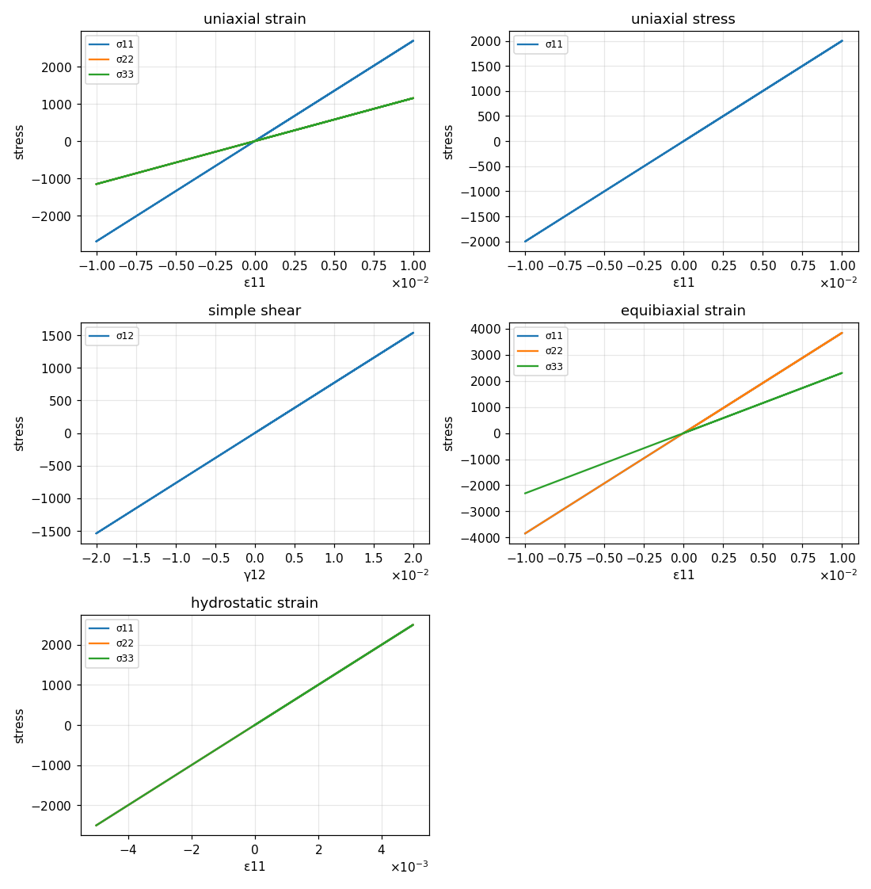
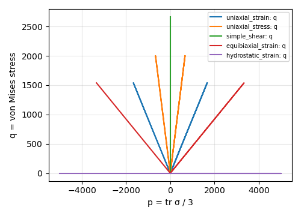
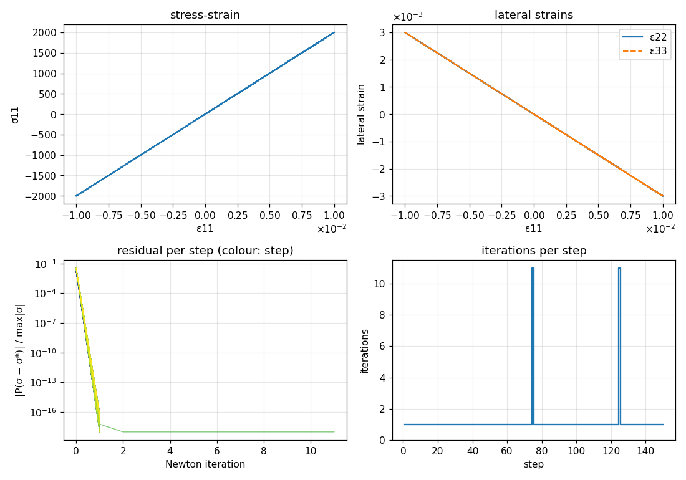
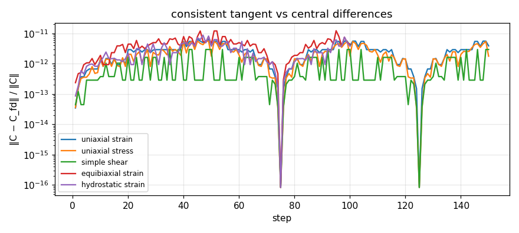

# linear_elasticity

Small-strain isotropic linear elasticity from bulk modulus $K$ and shear modulus $G$.

## Equations

$$
\boldsymbol{\sigma} = \mathbb{C} : \boldsymbol{\varepsilon}, \qquad
\mathbb{C} = 3K\,\mathbb{P}_\mathrm{vol} + 2G\,\mathbb{P}_\mathrm{dev}
$$

$$
\mathbb{P}_\mathrm{vol} = \tfrac{1}{3}\,\mathbf{I}\otimes\mathbf{I}, \qquad
\mathbb{P}_\mathrm{dev} = \mathbb{I}^\mathrm{sym} - \mathbb{P}_\mathrm{vol}, \qquad
\mathbb{I}^\mathrm{sym}_{ijkl} = \tfrac{1}{2}(\delta_{ik}\delta_{jl} + \delta_{il}\delta_{jk})
$$

Engineering constants: $E = \dfrac{9KG}{3K+G}$, $\nu = \dfrac{3K-2G}{2(3K+G)}$.

Closed-form responses used as checks:

| path | response |
|---|---|
| uniaxial strain $\varepsilon_{11}$ | $\sigma_{11} = (K + \tfrac43 G)\,\varepsilon_{11}$, $\sigma_{22} = \sigma_{33} = (K - \tfrac23 G)\,\varepsilon_{11}$ |
| uniaxial stress | $\sigma_{11} = E\,\varepsilon_{11}$, $\varepsilon_{22} = \varepsilon_{33} = -\nu\,\varepsilon_{11}$ |
| simple shear $\gamma_{12}$ | $\sigma_{12} = G\,\gamma_{12}$ |
| hydrostatic $\varepsilon_{ii} = \varepsilon$ | $\sigma_{ii} = 3K\,\varepsilon$ |

## Implementation

[`linear_elasticity.h`](../../../include/numsim-materials/materials/linear_elasticity.h)

| | name | type |
|---|---|---|
| parameter | `K`, `G` | number |
| parameter | `strain_producer_name` | material providing `strain` |
| input | `<strain_producer_name>::strain` | rank-2 tensor |
| output | `stress` | rank-2 tensor, updated on demand |
| output | `tangent` | rank-4 tensor, built once in the constructor |
| history | none | |

The tangent is assembled from the projectors with tmech (`otimesu`, `otimesl`, `otimes`); the stress is `dcontract(C, eps)`.
The material is path-independent, so every strain-controlled step needs no iteration and uniaxial stress converges in one Newton correction.

<!-- report:begin -->
## Results

Generated by `reports/make_report.py` from [`case.json`](case.json); do not edit.

| case | control | steps | iterations (max / mean) | max tangent error | converged |
|---|---|---|---|---|---|
| uniaxial_strain | strain | 150 | 0 / 0.00 | 6.4e-12 | yes |
| uniaxial_stress | uniaxial_stress | 150 | 11 / 1.13 | 5.6e-12 | yes |
| simple_shear | strain | 150 | 0 / 0.00 | 2.9e-12 | yes |
| equibiaxial_strain | strain | 100 | 0 / 0.00 | 1.2e-11 | yes |
| hydrostatic_strain | strain | 100 | 0 / 0.00 | 8.7e-12 | yes |

### Stress for prescribed strain paths

### Stress paths in the p–q plane

### Uniaxial stress (1D) and its Newton iterations

Strain 11 is prescribed; the other five strains are solved for zero stress with the material tangent.

### Tangent check

<!-- report:end -->
